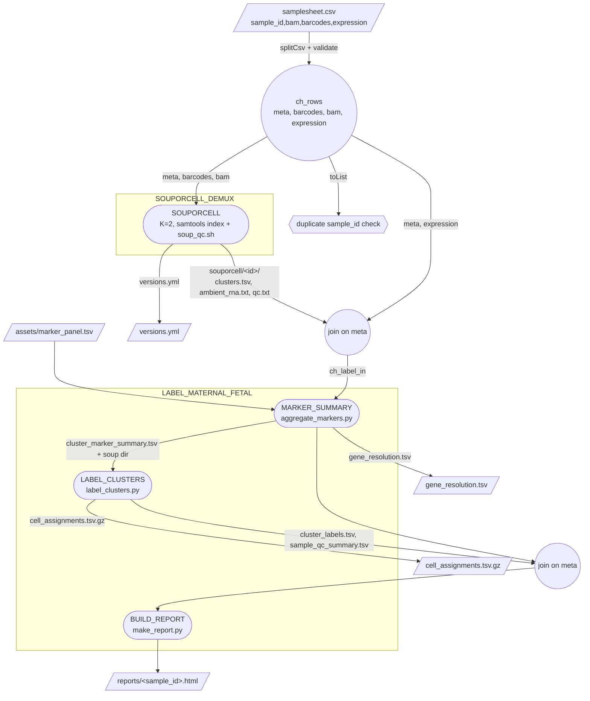
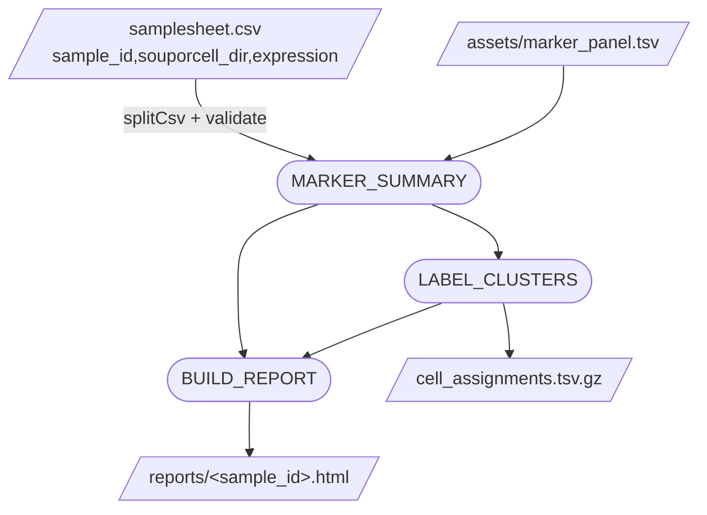
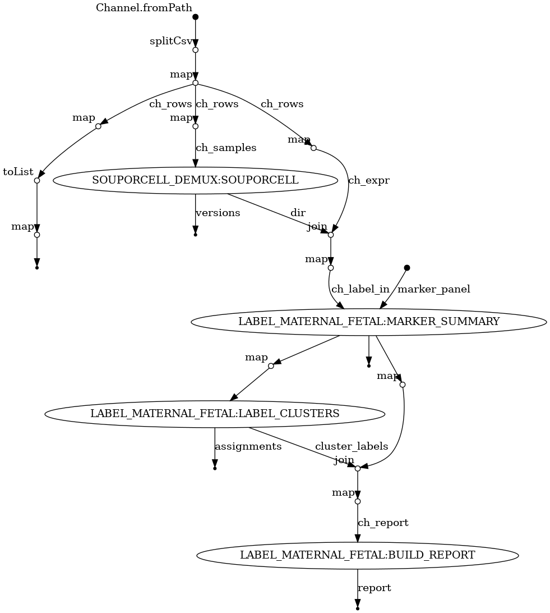

# Pipeline DAG

Two views of the same pipeline: a curated diagram that names the files moving between
processes, and the raw graph Nextflow emits from the actual channel topology.

## Regenerating

Nextflow builds the DAG from the workflow definition without running anything
(`-preview`), so no real data is needed — only paths that exist. Formats are chosen by
the output extension (`.mmd`, `.html`, `.dot`, `.svg`, `.png`; the last two need `dot`
on PATH).

```bash
module load cellgen/nextflow

# Full pipeline (SOUPORCELL + labeling). Needs a samplesheet whose paths exist;
# the files are never read under -preview, so empty stand-ins are fine.
nextflow run . -preview --input samplesheet.csv -with-dag docs/dag.svg

# Labeling-only entry, against the shipped fixture
nextflow run . -entry LABEL_ONLY -profile test -preview -with-dag docs/dag_label.mmd
```

`nextflow.config` also has `dag.enabled = true`, so every real run drops its own
`${params.outdir}/pipeline_info/dag.html`.

## Curated view — full pipeline



## Curated view — `-entry LABEL_ONLY`

Skips Souporcell entirely and takes existing Souporcell output directories from the
samplesheet, which is what makes `LABEL_MATERNAL_FETAL` independently runnable
(ROADMAP §4).



## Nextflow-generated view

Rendered from the real channel topology, so it also shows the operator nodes
(`map`, `join`, `toList`) between processes: [dag.svg](dag.svg) / [dag.png](dag.png).


