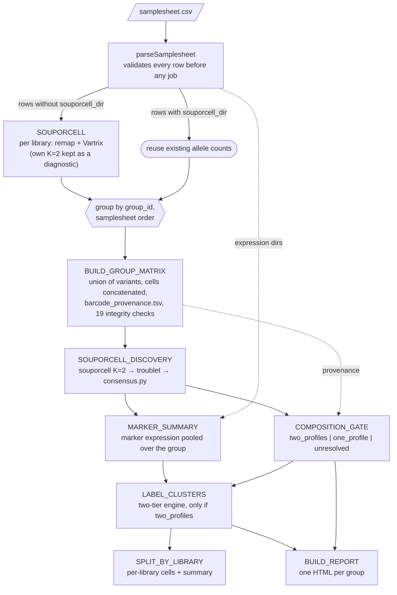

# Pipeline design

How `nf-demultiplex-matfet` demultiplexes maternal and fetal cells, why it is built this
way, and the evidence behind every threshold. The full validation record
(`docs/group_aware_redesign.md`) and the validation harness are kept in git under
`validation/group-matrix-core`, `validation/group-souporcell` and
`validation/group-vireo`, not on `main`. Result files cited below are under
`/lustre/scratch127/cellgen/cellgeni/tickets/REQ-68805/group_matrix/`.

## Why genotypes are inferred per pregnancy group

The first version ran Souporcell at K=2 on each library on its own. On REQ-68805
that gave one usable library in nine: Souporcell always returns two clusters, and
in a library with few fetal cells it halves the mother arbitrarily (Embryo-Imp15350363:
3,277 / 3,124 cells). Libraries from one pregnancy share the same mother and the
same fetus. Pooling them lets the fetal cells of every library support one fetal
profile: on CW5 the group run found 9 real fetal cells in 363 and 3 in 364, and
reproduced the trusted library 362 exactly (915 fetal / 5,427 maternal).

## Process DAG



| Process | Runs | Does |
|---|---|---|
| `SOUPORCELL` | per library | `souporcell_pipeline.py` with remapping (nf-demultiplex wrapper). Supplies `alt.mtx`, `ref.mtx`, `barcodes.tsv`, `common_variants_covered.vcf`. Skipped when the row gives `souporcell_dir`. |
| `BUILD_GROUP_MATRIX` | per group | `build_group_matrix.py` then `check_group_matrix.py`; any failed check fails the task. |
| `SOUPORCELL_DISCOVERY` | per group | Clustering, doublets and consensus on the group matrix, exactly as validated: seed 1, 4 threads, binary defaults otherwise. |
| `COMPOSITION_GATE` | per group | Decides whether the second genotype is real (below). |
| `MARKER_SUMMARY` | per group | Panel-marker detection and CP10K per cluster, summed over all the group's libraries. |
| `LABEL_CLUSTERS` | per group | Maternal/fetal orientation; withheld unless the gate says `two_profiles`. |
| `SPLIT_BY_LIBRARY` | per group | Joins labels back to libraries through `barcode_provenance.tsv`. |
| `BUILD_REPORT` | per group | `reports/<group_id>.html`. |

Libraries are put back in samplesheet order before the group matrix is built, so
the same samplesheet always produces the same matrix, and so the same discovery
result.

## Samplesheet contract

```csv
group_id,sample_id,bam,barcodes,expression,sample_role,expected_genotypes,souporcell_dir
```

| Column | Required | Rule |
|---|---|---|
| `group_id` | yes | Pregnancy group: libraries with one mother and one fetus. A one-library group is valid. |
| `sample_id` | yes | Unique across the whole samplesheet. Letters, digits, `.`, `_`, `-`. |
| `bam` | yes | CellRanger BAM. Remapping extracts each cell's reads from it, so it is always required. |
| `barcodes` | yes | Filtered cell-barcode file (optionally `.gz`). |
| `expression` | yes | CellRanger `filtered_feature_bc_matrix`; used for marker orientation. |
| `sample_role` | no, default `mixture` | `maternal_reference` is rejected: maternal reference libraries were designed but never validated. |
| `expected_genotypes` | no, default `2` | Anything else is rejected: K=4 pools and K=3 contamination were never validated. |
| `souporcell_dir` | no | Existing per-library Souporcell output. Its allele counts are reused and the library skips the remap (2.4-11.4 h). Must contain the four files above. |

Relative paths resolve against the samplesheet's own directory.

## Why Souporcell alone, without Vireo

Validation chose a Souporcell + Vireo hybrid on 2026-09-29: Souporcell to discover
the genotypes, Vireo to assign cells against them with the profiles held fixed, and
Vireo's confident-cell fraction as the gate. Before implementation, on 2026-10-01,
the existing outputs were re-read for a Souporcell-only signal that could do the
gate's job. One was there: the ambient RNA fraction that `consensus.py` fits, which
separated every real split from every fake one in validation. It became the first
gate, and was replaced on 2026-10-05 by the discordant fraction once production
data showed it did not transfer across chemistries (see *Composition gate*). Both
are Souporcell-only signals; the argument below holds for either.

Vireo was dropped because, once a Souporcell-only gate exists, it adds nothing the
evidence shows we need:

- **Assignment quality is the same** where both pass. Souporcell alone at 1% fetal
  cells: recall 0.99, precision 0.89-0.99; hybrid 0.94-0.99 / 0.93-1.00. At 2% and
  above the two are indistinguishable, including Souporcell's unexplained 5% dip,
  which the hybrid inherits (`spikein/report/detection_curve.tsv`).
- **The Souporcell-only gate has been checked on real groups** (all 27 production
  groups); the hybrid never ran on one.
- **One tool, one fewer process**, and Souporcell's `clusters.tsv` is already the
  format the labelling code reads.

What does *not* justify dropping Vireo: we did not show the hybrid is worse. If the
Souporcell-only gate fails on production groups, the hybrid is the documented fallback.
Vireo's role was never discovery: as a discoverer it splits arbitrarily below ~5%
fetal cells (precision 0.01-0.06).

## Composition gate

### The signal

Souporcell at K=2 always returns two clusters. When a group holds only one genotype,
the two clusters are arbitrary halves of it, and their consensus genotype profiles
are near-copies. The gate measures how different the two profiles are:

> **discordant fraction** = loci where the two profiles' genotype calls differ ÷
> loci called in both profiles

A mother and her fetus share one allele at every locus but still differ at roughly
half of the informative ones; two halves of one person differ only where noise
makes their calls disagree. Because it is a fraction, it does not grow with depth
or cell number, which is what disqualified the raw separating-loci count.

### The evidence

Every Souporcell discovery run in validation, re-read from
`consensus/cluster_genotypes.vcf` with the pipeline's own function (59 runs):

| Runs | Truth | Discordant fraction |
|---|---|---|
| Spike-in 0% (full groups and halves), CW4 `trio_early`, 6 per-library fake splits | no second genotype | **0.17-0.30** (13 runs) |
| CW4 `all5`, `balanced2k`, `trio_late`, `trio_mixed`; per-library Embryo-Imp15289127 | collapsed to one genotype | not computable: no locus called in both (5 runs) |
| Spike-in 1-10% (full groups, halves, seeds 2-3), CW5 joint seeds 1-3, CW5 anchor, library 362 | real fetus | **0.53-0.66** (33 runs) |
| Spike-in 0.5% (17-42 fetal cells per full group or half) | real, weak | 0.64-0.94 (6 runs; one half-group with 17 cells is `one_profile`) |
| D6 FCA7167231 alone, group and per-library | unknown | 0.64 |

The threshold was then checked, not chosen, on the first 22 production groups
(REQ-68805, 3' v4, 3' v2, 5' v3 and mixed chemistry): fake splits read 0.27-0.36,
real ones 0.44-0.72. Real here means marker-supported: RPS4Y1 restricted to the
minority genotype, or a fetal fraction that follows tissue (placenta 61-98% fetal,
decidua 0-19%).

### Why it replaced ambient RNA

The first gate used `consensus.py`'s fitted ambient RNA, which separated validation
perfectly (real 1-9%, fake 84-100%), all from 3' v4 fallopian-tube data. On
production data it failed: two groups with a male fetus (CW15, RPS4Y1 in 20% of the
minority and 0% of the majority; Hrv43, 18% vs 0.4%) fitted 34% and 72% ambient
and were withheld, while fake splits fitted as low as 62%, and D7, whose two
profiles differ at only 0.27 of loci, fitted 12.6% and was accepted. The discordant
fraction separates all of these correctly. Ambient is still reported as QC.

### The thresholds

| Parameter | Default | Why this value |
|---|---|---|
| `gate_min_discordant_fraction` | 0.40 | Inside the validation gap (highest fake 0.30, lowest real 0.53), chosen from validation alone. It also separates every production group seen so far (highest fake 0.36, lowest real 0.44); that margin is narrower, so it is the number to watch on new data. |
| `gate_min_minority_singlets` | 20 | A second profile needs enough cells to be a genotype. Validation showed that a thinly trained minority profile makes real fetal cells look like doublets (retention fell from 99.6% to 31.8% when training support was halved). 20 sits below the smallest accepted real minority (~30 cells in a 1% half-group) and stops a handful of cells being called a fetus. |

### The verdicts

| Verdict | When | What the pipeline does | Why |
|---|---|---|---|
| `unresolved` | no locus called in both profiles | No maternal/fetal labels; clusters reported as `unresolved`. | Souporcell collapsed to one genotype, so there is no second profile to test. |
| `unresolved` | discordant fraction < 0.40 | Same. | The fake-split signature: the two clusters are halves of one person. Calling that unresolved rather than "maternal only" is deliberate: the group holds one genotype, and without a second cluster the panel cannot say whether it is the mother's or the fetus's (a placenta-only library could be all fetal). |
| `one_profile` | fraction ≥ 0.40 but minority < 20 singlets | No maternal/fetal labels. | The profiles differ but the second one is too small to be a usable genotype. It is a safety net: no run so far produced this combination. The single profile is **not** labelled maternal, for the reason above. |
| `two_profiles` | fraction ≥ 0.40 and minority ≥ 20 singlets | Marker orientation runs. | Every real split in validation and production lands here. |

### Reported, but not used to decide

| Metric | Why it is not a gate |
|---|---|
| Fitted ambient RNA | Did not transfer across chemistries (above). |
| Separating loci (raw count) | Grows with depth and cell number: CW4 `trio_early`, a fake split, had 16,660, the level of a real fetus at 1%. The fraction normalises it. |
| Doublet fraction | The 5% spike-in dip shows inflated doublets with precision still 1.00: it flags lost fetal cells, not a false fetus. |
| Missing genotype calls | Souporcell writes `./.` for loci it cannot call; not calibrated. |
| Split-half locus replication | Dead end for Souporcell profiles: 0.75-0.93 at every fraction, including 0%. Not computed. |

### Limits

- **A second genotype is not necessarily a fetus.** Two people of any relationship
  differ at a high fraction of loci, so a sample mix-up passes the gate like a
  fetus. D6 and D7 show this: their two genotypes segregate by library, and D6's
  blood library FCA7167232 matches D7's decidua genotype. Marker orientation then
  finds no fetal evidence, so no wrong label is written, but the gate alone cannot
  catch it.
- **The 0.5% case is now accepted.** Those runs hold a real fetus (Souporcell recall
  1.00, precision 0.83-0.85 at 35 fetal cells in 7,000), so the cost is a few false
  fetal cells in very low-fraction groups, never an invented fetus.
- Validation is synthetic groups from one pregnancy plus CW4/CW5; production
  checks rest on marker and tissue consistency, not independent genotypes. **Never
  tune a threshold to make a run pass**: a result that contradicts validation is a
  bug to investigate.

## Orientation: which cluster is fetal

Genotype clusters are neutral (`0`, `1`). Orientation uses expression of a small,
version-controlled panel ([`assets/marker_panel.tsv`](../assets/marker_panel.tsv)),
pooled across all of the group's libraries, singlets only. Because the profiles are
shared, one decision per group applies to every library, including libraries with
almost no fetal cells.

| Gene | Note |
|---|---|
| **RPS4Y1** | Y chromosome. Cell-type-independent; fires in all fetal cells of a male fetus, absent (beyond ambient) in maternal cells. |
| HAPLN1, PITX2, GAPLINC, HPGDS, XAGE2, XAGE3 | Fetal/placental. Largely trophoblast/placental-lineage and cell-type-specific. |
| HLA-G | Extravillous trophoblast, fetal. |

Genes are resolved to the matrix at runtime (symbol, then alias, then Ensembl ID)
and the run fails loudly if any is missing, or if libraries in a group resolve a
gene differently.

**Two-tier decision engine** (`bin/label_clusters.py`):

1. **RPS4Y1 override.** If one cluster has RPS4Y1 fraction-positive ≥
   `rps4y1_fraction_floor` and ≥ `rps4y1_min_fold` enrichment over the other, it is
   fetal (high confidence, male) and the other is maternal. The enrichment
   requirement stops ambient RPS4Y1 in the maternal cluster from tripping the call.
2. **Secondary vote.** If RPS4Y1 is uninformative, each other marker votes for the
   cluster it is enriched in. A clear margin (`min_vote_margin`) gives a fetal call
   capped at provisional confidence (likely female), because female-fetus calls are
   internally consistent but not independently validated.
3. **Otherwise `unresolved`.** Never forced.

Safeguards, each covered by a unit test:

- Absence of RPS4Y1 only moves the decision to tier 2; it is never maternal evidence.
  `maternal_likely` is only ever the *other* cluster once a fetal one is identified.
- Markers similar in both clusters mean ambient RNA, not two fetal clusters → `unresolved`.
- Clusters with fewer than `min_cluster_cells` (50) singlets downgrade a high-confidence
  call to provisional. The gate's 20-singlet floor is lower on purpose: the gate
  decides whether a genotype exists, the label threshold how confident its
  orientation is.
- Doublets and unassigned cells keep those labels; they are never coerced.
- Any gate verdict other than `two_profiles` withholds every label.

## Outputs

| Path | Content |
|---|---|
| `souporcell/<sample_id>/` | Per-library Souporcell run (only for libraries the pipeline remapped). Its own K=2 clusters are a diagnostic; do not use them as results. |
| `groups/<group_id>/matrix/` | `barcode_provenance.tsv`, `library_offsets.tsv`, `matrix_qc.tsv`, `manifest.json`, `integrity_check.txt`. The large matrices stay in the work directory. |
| `groups/<group_id>/discovery/` | `clusters.tsv`, `clusters_tmp.tsv`, `cluster_genotypes.vcf`, `ambient_rna.txt`, stage logs. |
| `groups/<group_id>/gate.tsv` | Verdict, reason, ambient, cluster sizes, QC metrics, the thresholds used. |
| `groups/<group_id>/gate_libraries.tsv` | Per-library cells, singlets per cluster, doublets, unassigned. |
| `groups/<group_id>/cluster_marker_summary.tsv` | Per cluster × marker, pooled over libraries. |
| `groups/<group_id>/cluster_labels.tsv` | Per cluster: label, confidence, rule, supporting markers, reason, warnings. |
| `groups/<group_id>/group_qc_summary.tsv` | Gate verdict, orientation verdict, counts, ambient, warnings. |
| `<sample_id>/cell_assignments.tsv.gz` | Per barcode: group, Souporcell status and cluster, label, confidence, reason. |
| `<sample_id>/library_summary.tsv` | Per library: gate verdict, status counts, cells per label. |
| `reports/<group_id>.html` | Human-readable report. |

Label vocabulary: `fetal_high_confidence_male`, `fetal_marker_supported`,
`maternal_likely`, `unresolved`, `doublet`, `unassigned`.

## Resources

| Process | Measured in validation | Requested |
|---|---|---|
| `SOUPORCELL` (per library, remap) | 2.4-11.4 h (median 5.6 h), 13-16 GB on 64 REQ-68805 libraries | 16 cpus, 35 GB, 24 h |
| `BUILD_GROUP_MATRIX` | 0.2-1.5 GB, < 7 min per build (1-5 libraries) | 1 cpu, 4 GB × attempt, 4 h × attempt |
| `SOUPORCELL_DISCOVERY` | CW5 19,336 cells 7.6 GB / 16 min; CW4 36,800 cells 18.4 GB / 68 min (4 threads) | 4 cpus, 24 GB × attempt, 8 h × attempt, 2 retries |
| `COMPOSITION_GATE` | ~1 s on CW5 | 1 cpu, 4 GB, 1 h |

Discovery on 10-15 libraries has not been measured; memory doubles on each retry.

## Acceptance tests

Agreed before implementation. A result that contradicts validation is a bug to fix,
not a reason to reopen experiments.

- **REQ-68805 CW5** reproduces: 362 ≈ 915 fetal / 5,427 maternal; 363 and 364 carry
  only a handful of fetal cells (9 and 3); gate `two_profiles`.
- **CW4** (5 libraries) comes out `unresolved`.
- **A 10-15 library group** is the scale test.

## Not supported yet

- `maternal_reference` libraries (a known maternal profile as an anchor).
- `expected_genotypes` other than 2 (K=4 pools of two pairs; K=3 contamination).
- A Vireo assignment step (the documented fallback if the discordant-fraction gate fails).
